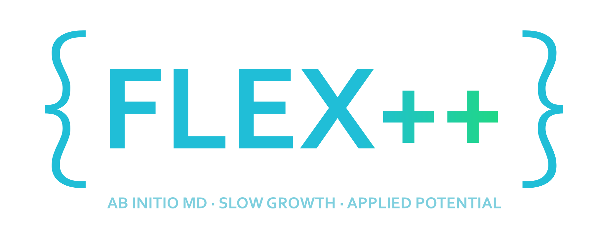

<p align="center">
  
</p>


**FL**uctuation-dissipation **EX**tension for VASPsol++

`FLEX++` is a toolkit to perform ab initio molecular dynamics (AIMD) simulations with an applied potential, and slow-growth dynamics on top of them.
 
Two approaches are available for controlling the electrode potential:
 
- **Thermopotentiostat.** This approach uses the fluctuation-dissipation theorem to control the charge and the potential. Both the charge and the applied potential are allowed to fluctuate following a Gaussian distribution, with the potential building the Gaussian around the user's target potential.
- **Fixed-potential ensemble.** In this approach, the charge is allowed to vary while the potential is fixed to a value chosen by the user.
The slow-growth approach can be combined with either method. `FLEX++` interfaces with both `VASPsol++` and `VASPsol`.
 
It is an external standalone code, interacting with VASP via the ASE interface, needless of any extra and elaborate patching on VASP.

Please make sure to cite the following if you use `FLEX++` in your research:

- ChemRxiv. [[link]](https://chemrxiv.org/) <!-- add DOI / link once available -->

## Requirements

- `Python` 3.6 or higher
- `ASE` 3.22.1 or higher
- `VASP` 5.4.1 or higher, with the `VASPsol++` or `VASPsol` add-on

## Installation

If your machine has Git installed, simply clone the repo to your local directory by:

```
git clone https://github.com/rena-96/FLEX-plusplus
```

Or, you can download and unzip the source code:

```
wget https://github.com/rena-96/FLEX-plusplus/archive/refs/heads/master.zip
unzip master.zip
rm master.zip
mv FLEX-plusplus-master flexpp
```

After fetching the repo, add it to your `PYTHONPATH` by:

```
export PYTHONPATH=$PYTHONPATH:/absolute/path/to/directory/flexpp/
```
 
Add it to your `~/.bashrc` or to the submission script, so that the `FLEX++` package can be found when you run the job. It needs to be the absolute path! 

After these, run the following line to test:

```
python -c 'import flexpp'
```

If no error occurs, `FLEX++` should have been imported into your path.

#### ASE-related settings

In the job submission script, you should load the ASE and VASP modules, plus the `PYTHONPATH` for FLEX++. It will look like this:
```
module load YOUR_VASP_VERSION
module load ASE
export PYTHONPATH=$PYTHONPATH:/xxx/flexpp

export ASE_VASP_COMMAND="mpiexec vasp_std" # or your ASE command
```

Some HPCs have a different configurations fro  `VASP_COMMAND` or `ASE_VASP_COMMAND`, so ask your local HPC support for configuring it for your settings. We added an example for slurm. 

Learn more about VASPsol++ [here](https://github.com/VASPsol/VASPsol/). 

For this module kit, we took inspiration from [Electrochemical Optimizer](https://github.com/zishengz/echo/).


## Tutorials

Check our `tutorial` folder! Further explanation is given there. 

## Authors

Developed by Renata Sechi, Ph.D., and Ronan Gleeson, M.Sc. at the Hansen's Group at DTU Energy. 

## License

Copyright © 2026 Technical University of Denmark.
